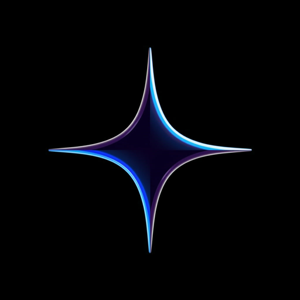

<p align="center">
  
</p>

# PrismLock

**Fingerprint artwork and touch effects for Samsung.**

PrismLock is an experimental LSPosed module with a native Android catalog of
fingerprint designs and unlock touch animations. It changes visual resources in
Samsung's biometrics app, not the authentication result or sensor behavior.

> Development preview: **0.2.0-preview**. This repository is private while
> third-party redistribution permissions and device acceptance are reviewed.
> No public download or stable release is available yet.

## Features

- 28 fingerprint designs and 18 touch effects with separate selections.
- Automatic saving, English interface, and system/light/dark appearance.
- Colored, black/light-mode and white/AOD variants for Prism, Vortex, Orbit and Neon.
- Separate fingerprint and animation previews with size normalization.
- Optional PNG or Lottie imports for light and dark/AOD modes.
- A customization switch that passes through to Samsung's stock resources.

## Requirements

- A rooted Samsung device with LSPosed and compatible in-display fingerprint UI.
- Module scope: `com.samsung.android.biometrics.app.setting` **only**.
- A recovery path for disabling modules if the biometrics UI misbehaves.

Development has used a Galaxy S23 (SM-S911B) with a custom One UI 9 / Android 17 ROM.
The user has reported working lockscreen icons and touch effects. Compatibility
with other devices and firmware is unverified; this is not a general support claim.
The 0.2.0 Aqua update and AOD variants still require physical device acceptance.

## Installation

1. Build a development APK using the instructions below and install it.
2. Enable **PrismLock** in LSPosed with only the scope listed above.
3. Follow LSPosed's module activation/restart requirements. PrismLock does not
   restart system processes or reboot the phone automatically.
4. Choose a fingerprint and touch effect. Selections save automatically; there
   is no Apply button.
5. Turn off LockStar's fingerprint effect to avoid conflicting effects.

**Migrating from the research preview:** the package changed from
`com.fpring.samsung` to `io.github.aureliomo.prismlock`. Android treats these as
different applications. Disable the old module before enabling PrismLock, and
reselect your preferences in the new app. Do not enable both modules together.
Old research-preview data is not deleted automatically.

To return to stock artwork, turn off customization. To fully unload the hooks,
disable the module in LSPosed and follow its restart requirements. Do not replace
or re-sign Samsung's system APK.

## Build

Requires JDK 17, Python 3.10+ for catalog checks, Android SDK platform 36 and access
to Google Maven, Maven Central and the Xposed API repository. Gradle 8.13 is pinned
by the checked-in wrapper and its SHA-256 checksum.

```sh
export ANDROID_HOME=/path/to/your/android-sdk
python3 scripts/check_catalog.py
./gradlew --no-daemon assembleDebug
```

On Windows use `gradlew.bat`. Android Studio can use the same wrapper and JDK 17.
The debug APK is written to `app/build/outputs/apk/debug/app-debug.apk`.
Debug builds use the local Android debug key; they are not release-signed builds.
Different developer or CI keys cannot update an already-installed build in place.

The optional `scripts/generate_icons.py` requires Pillow. Normal builds do not
require Pillow because generated launcher icons are checked in.

## Repository layout

```text
app/                 Android app, module hooks and runtime catalog assets
docs/                Architecture, device validation, branding and provenance
gradle/wrapper/      Pinned Gradle wrapper and checksum
scripts/             Portable catalog checks and launcher-icon generation
.github/             Build workflow and issue/PR templates
```

Research APKs, decompiled firmware, device dumps, build caches, old APKs, local SDKs,
private device screenshots and signing keys are deliberately not part of this repo.

## Documentation

- [Architecture](docs/architecture.md)
- [Device acceptance checklist](docs/testing.md)
- [Third-party notices and release blockers](docs/third-party-notices.md)
- [Contributing](CONTRIBUTING.md)
- [Security reporting](SECURITY.md)
- [Changelog](CHANGELOG.md)

## Credits and licensing

Developed by [AurelioMo](https://github.com/AurelioMo). The supplied Fingerprint
Catalog by **custombeta** informed the catalog reconstruction; **ELPEDR/RingPrint**
provided Samsung integration research, not the app's interface design. Samsung
resources and user-supplied artwork retain their respective ownership.

No blanket open-source license is granted for this mixed-provenance repository.
Public redistribution is blocked until the permissions described in the notices
are resolved. PrismLock is not affiliated with Samsung, Xiaomi, Good Lock or LSPosed.
