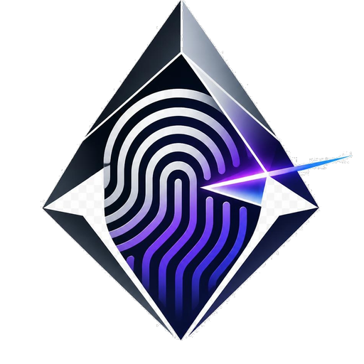
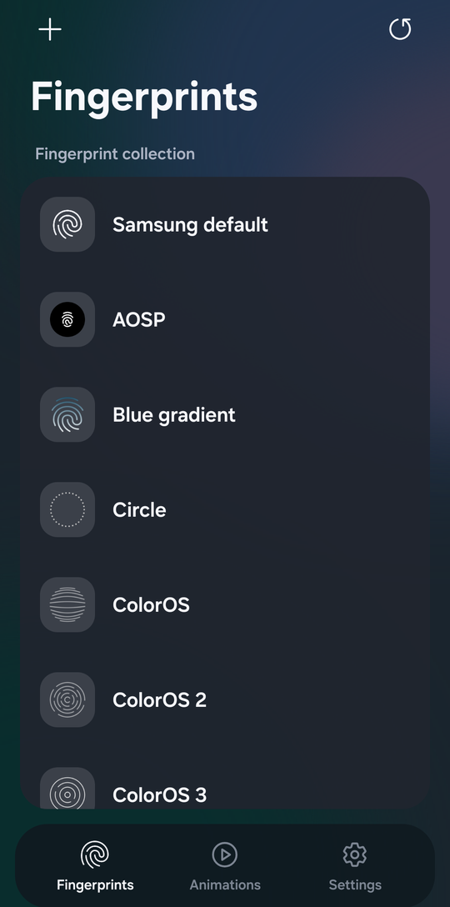
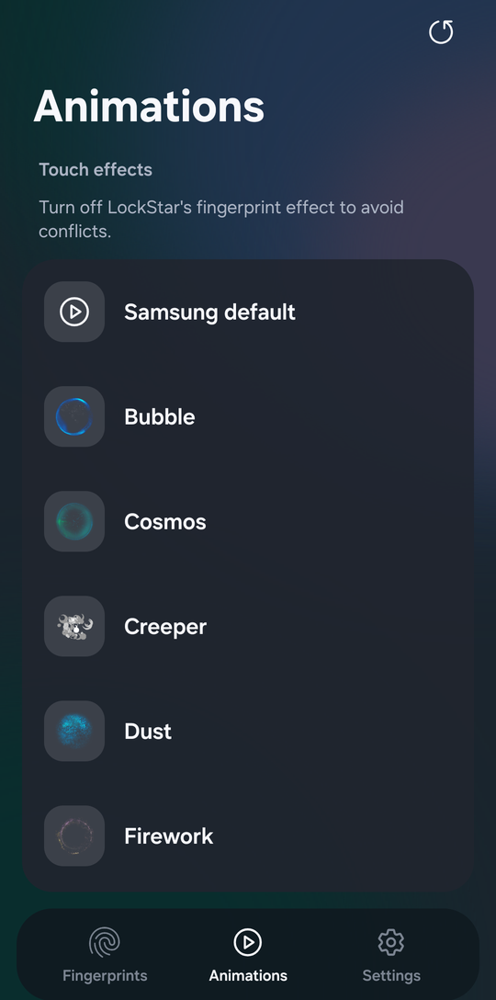
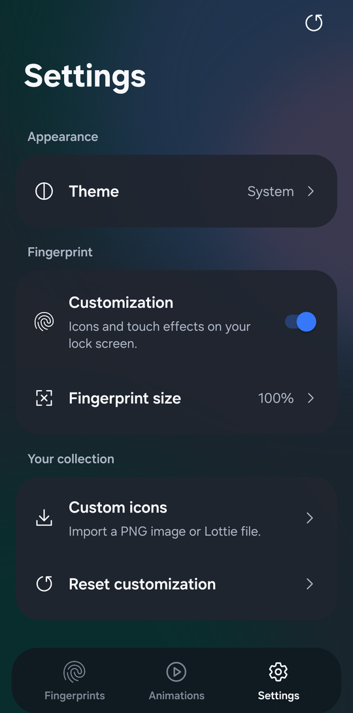

<div align="center">
  
  <h1>PrismLock</h1>
  <p>Fingerprint icons and touch animations for Samsung devices.</p>
</div>

[](https://github.com/AurelioMo/prismlock/releases)
[](https://github.com/LSPosed/LSPosed)
[](https://github.com/AurelioMo/prismlock/actions/workflows/build.yml)
[](https://github.com/AurelioMo/prismlock/tree/main/app)

PrismLock is an Xposed / LSPosed module that replaces fingerprint icons and touch
effects on Samsung One UI. Choose a design from the built-in catalog or import your
own PNG or Lottie artwork. Changes save automatically.

The module hooks Samsung's fingerprint asset loader instead of modifying a system APK.
That is the same device-independent technique used by RingPrint: it works across
Samsung devices and One UI builds, not only on one model or firmware version.

## Download

**[Download the latest APK from Releases](https://github.com/AurelioMo/prismlock/releases).**
Open the newest release, expand **Assets**, and download `PrismLock-*.apk`.
The source ZIP/TAR files are not installable apps.

Current version: **1.4.2**.

## Compatibility

| Component | Requirements |
| --- | --- |
| Module framework | LSPosed / compatible framework with modern libxposed API 102 support |
| Devices | Samsung One UI with an in-display fingerprint sensor |
| Android | 8.0 or newer (API 26+) |
| Module scope | `com.samsung.android.biometrics.app.setting` |
| Reference device | Galaxy S23 / SM-S911B |

PrismLock does not target a specific Samsung model. It intercepts the fingerprint
resources Samsung requests at runtime, so the same APK works across One UI devices.

## Installation

1. Download and install the APK from **[Releases](https://github.com/AurelioMo/prismlock/releases)**.
2. Use a framework supporting **libxposed API 102**, activate **PrismLock**, and select only the scope listed above.
   If upgrading from 1.0.3 or older, recheck module activation after the API migration.
   Restart the scoped process or reboot so Samsung loads the new module code;
   an already running legacy process retains its old clipping behavior until restarted.
3. Follow LSPosed's activation/restart requirements.
4. Open PrismLock and select a fingerprint and animation. There is no Apply step.
5. If you use LockStar, turn off its fingerprint effect to avoid overlapping effects.

If you previously used the old `com.fpring.samsung` research package, uninstall it
before enabling PrismLock. The packages are different and preferences do not migrate.

## Updates

PrismLock checks GitHub Releases in the background whenever the app enters the
foreground. A newer stable version is offered directly on the current screen;
**Settings → App → Updates** also lets you check manually. Concurrent checks share
one network request, and a failed request can be retried immediately.

The APK is downloaded directly from GitHub and installed in place. Rooted devices use
a silent `pm install`; otherwise Android's system installer asks for confirmation.
Your settings and selections are preserved.

## Features

- Built-in library of **36 fingerprint families** and **22 touch-effect families**, including Keqing, Pyro, Orbit, Pulse, Orb, Lotus and Snowflake, with alternate color/motion styles grouped inside each family.
- Independent fingerprint and effect selection with automatic saving.
- Native style picker for shared designs; old selections and alternate colors remain available.
- Built-in 120fps playback timelines with temporal interpolation and unchanged durations; up to 120Hz UI refresh on supported displays.
- Aligned title/style columns, coalesced thumbnail loading and idle-expiring background workers.
- Color, black/light-mode and white/AOD variants for Prism, Vortex, Orbit and Neon.
- PNG and Lottie imports for light and dark/AOD modes.
- Separate fingerprint and animation previews with visible-bound size normalization.
- English interface with system, light and dark appearance.
- Smaller **0.8-second Aqua effect** with a transparent final frame.
- Customization switch to pass through to Samsung's default visual resources.
- Modern libxposed API 102 integration with background configuration loading.
- Recycled catalog rows and asynchronous thumbnail/wallpaper loading.
- Enlarged icon glows can extend beyond the Lottie artboard on compatible Samsung renderers.
- In-app GitHub update checker and installer, with automatic foreground checks.

The module changes visual resources only. It does not change authentication,
enrollment, illumination masks, brightness control or sensor behavior.

## Screenshots

| Fingerprints | Animations | Settings |
| :---: | :---: | :---: |
|  |  |  |

## Source and build

Requires JDK 21, Android SDK platform 36 and Python 3.10+ for catalog validation.
Gradle 8.13 is pinned in the checked-in wrapper.

```sh
export ANDROID_HOME=/path/to/your/android-sdk
python3 scripts/check_catalog.py
./gradlew --no-daemon assembleDebug
```

On Windows use `gradlew.bat`. The debug APK is in
`app/build/outputs/apk/debug/app-debug.apk`. For signed distribution builds, follow
[release signing](docs/signing.md); never commit credentials or keystores.

```text
app/                 Android application, hooks and runtime artwork
docs/                Architecture, release signing, testing and provenance
gradle/wrapper/      Pinned build wrapper
scripts/             Catalog validation and icon generation
.github/             CI and issue/PR templates
```

See [architecture](docs/architecture.md), [release signing](docs/signing.md),
[release validation](docs/testing.md), [contributing](CONTRIBUTING.md),
[security](SECURITY.md) and [changelog](CHANGELOG.md).

## Credits

Developer: **[AurelioMo](https://github.com/AurelioMo)**.
Report bugs and suggestions through **[Issues](https://github.com/AurelioMo/prismlock/issues)**.

Original catalog reference and artwork: **custombeta / Fingerprint Catalog**.
Samsung integration research: **ELPEDR / RingPrint**.
Aqua animation, Prism/Vortex/Orbit/Neon/Orb/Lotus/Snowflake artwork, the Orbit and
Pulse effects and the PrismLock logo were supplied for this project. Samsung resources retain their respective ownership.
PrismLock is not affiliated with Samsung, Xiaomi, Good Lock or LSPosed.

Third-party materials are credited here and in
[third-party credits](docs/third-party-notices.md). They remain the property of
their respective owners and are not relicensed by this repository.
